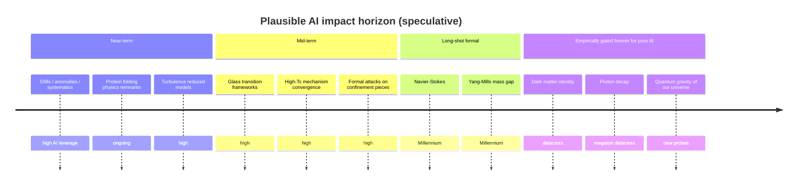

# AI / LLM Tractability Map

Estimate of whether **current + ~2-generation-ahead LLMs / scientific AI systems** could *plausibly close* a problem (with human verification), not merely discuss it.

## Rubric

- **high**: Formal proof, mechanism from existing data, or computational theory problem where AI reasoning/simulation can plausibly close or nearly close the problem.
- **medium**: AI can accelerate theory/model selection substantially, but decisive progress needs new experiments or facilities.
- **low**: Empirically gated or underdetermined; AI helps explore theory space but cannot decide alone.
- **none**: Requires new discovery-class experiments, Planck-scale access, or is not uniquely decidable by science as currently framed.

## Distribution

| Level | Count | Share |
|-------|------:|------:|
| 🟢 high | 47 | 42% |
| 🟡 medium | 34 | 30% |
| 🟠 low | 26 | 23% |
| 🔴 none | 5 | 4% |

## 🟢 High — best AI physics targets

Formal, data-rich, or mechanism-from-existing-theory problems.

| Problem | Field | Kind | Impact | Why AI-plausible |
|---------|-------|------|--------|------------------|
| Color confinement (analytic proof) | particle-physics | mathematical | 5 | Closely related to mass gap; lattice evidence strong but proof missing. |
| High-temperature superconductivity mechanism | condensed-matter | theoretical | 5 | Huge data; theory model selection + materials AI; mechanism still debated. |
| Navier–Stokes existence and smoothness | fluid-dynamics | mathematical | 5 | Pure analysis; among best LLM/AI math targets. |
| Post-quantum cryptography proofs | quantum-information | mathematical | 5 | Formal security reductions; high AI leverage. |
| Rigorous interacting 4D QFT | mathematical-physics | mathematical | 5 | Mathematical physics; AI can assist constructive methods and proofs. |
| Statistical theory of turbulence | fluid-dynamics | theoretical | 5 | Data-rich; ML + theory of cascades/structure functions highly promising. |
| Yang–Mills existence and mass gap | mathematical-physics | mathematical | 5 | Pure formal math; top AI formal-reasoning target among physics problems. |
| BQP vs BPP / NP relations | quantum-information | mathematical | 4 | Complexity theory; formal methods friendly. |
| Core-collapse supernova mechanism | astrophysics | theoretical | 4 | Multi-physics simulation + AI surrogates; converging but not closed. |
| Cosmic censorship hypothesis | quantum-gravity | mathematical | 4 | Mathematical GR conjecture; partial results exist; AI formal math could help. |
| Fractional quantum Hall ν=5/2 state | condensed-matter | theoretical | 4 | Focused condensed-matter theory + numerics. |
| Glass transition | condensed-matter | theoretical | 4 | Conceptual + computational stat-mech; major AI theory target. |
| Protein folding physics (beyond structure prediction) | biophysics | theoretical | 4 | Structure prediction largely advanced by AlphaFold-class models; kinetic/thermodynamic physics still open. |
| Topological order at finite temperature | condensed-matter | theoretical | 4 | Theory + numerics of topological codes. |
| Alfvénic turbulence | plasma-physics | theoretical | 3 | Data-rich space plasma statistics. |
| Astrophysical jets and QPOs | astrophysics | theoretical | 3 | GRMHD + ML pattern discovery in timing data. |
| EMC effect | nuclear-physics | theoretical | 3 | Nuclear PDF phenomenology + short-range correlations. |
| Exotic hadrons structure | particle-physics | theoretical | 3 | Spectroscopy + lattice + amplitude analysis. |
| Fermi acceleration injection problem | plasma-physics | theoretical | 3 |  |
| Gene expression noise and developmental robustness | biophysics | theoretical | 3 |  |
| Geometric Langlands and physics | mathematical-physics | mathematical | 3 | Deep math; formal AI systems may help bridges. |
| Homochirality origin | biophysics | theoretical | 3 | Kinetic/symmetry-breaking models. |
| Neutron lifetime puzzle | particle-physics | experimental | 3 | Classic systematics + nuclear theory reconciliation problem. |
| Proton spin crisis | particle-physics | theoretical | 3 | Global QCD analyses + lattice; data-driven. |
| Quantitative immune system networks | biophysics | theoretical | 3 |  |
| Quantum biology functional coherence | biophysics | theoretical | 3 | Rigorous model audit of claims is AI-friendly. |
| Quantum channel capacity | quantum-information | mathematical | 3 | Quantum information theory math. |
| Reactor antineutrino anomaly | particle-physics | experimental | 3 | Nuclear data + flux models; sterile neutrino hypothesis testable. |
| Solar coronal heating problem | astrophysics | theoretical | 3 | Solar data + MHD/kinetic models; AI-assisted reconnection theory. |
| Solar cycle and dynamos | astrophysics | theoretical | 3 | Nonlinear dynamo theory + long solar records. |
| Diffuse interstellar bands | astrophysics | experimental | 2 | Classic spectral matching + molecular database search—excellent AI target. |
| Galactic age–metallicity relation | astrophysics | experimental | 2 | Survey data + chemical evolution models. |
| Gallium anomaly | particle-physics | experimental | 2 | Analysis and nuclear physics heavy. |
| Granular convection / Brazil-nut effect | fluid-dynamics | theoretical | 2 | Soft-matter simulation + theory; much progress already. |
| Helium-4 superfluid critical exponent α | condensed-matter | theoretical | 2 | RG + finite-size effects reconciliation. |
| Kuiper cliff | astrophysics | theoretical | 2 | N-body Solar System formation simulations. |
| Low-T amorphous solid universality | condensed-matter | theoretical | 2 |  |
| Magnetoreception mechanism | biophysics | experimental | 2 | Radical-pair vs other models; biophysics theory + experiments. |
| Metal whiskering | condensed-matter | theoretical | 2 | Materials multi-scale simulation problem. |
| Nematic–smectic-A transition universality | condensed-matter | theoretical | 2 |  |
| Origin of p-nuclei | astrophysics | theoretical | 2 | Reaction networks + stellar models. |
| Cryogenic electron emission anomaly | condensed-matter | experimental | 1 |  |
| Flyby anomaly | astrophysics | experimental | 1 | Likely systematics; trajectory reanalysis. |
| Gauge block wringing | condensed-matter | theoretical | 1 |  |
| Quantum-dot energy-size nonparabolicity | condensed-matter | theoretical | 1 |  |
| Scharnhorst effect | condensed-matter | theoretical | 1 | Theoretical consistency clarification; no causality violation expected in practice. |
| Sonoluminescence mechanism | condensed-matter | theoretical | 1 | Likely closeable with careful multi-physics modeling. |

### Top-tier AI moonshots (high tractability × high impact)

1. **Color confinement (analytic proof)** (`color-confinement`) — Provide an analytic proof that color-charged particles are confined in non-Abelian gauge theory / QCD.
1. **High-temperature superconductivity mechanism** (`high-tc`) — What mechanism causes high-Tc superconductivity in cuprates and related materials? Is room-temperature ambient SC possible?
1. **Navier–Stokes existence and smoothness** (`navier-stokes`) — Do smooth solutions to 3D incompressible Navier–Stokes exist for all time for nice initial data, or do singularities form? (Clay Millennium)
1. **Post-quantum cryptography proofs** (`pqc-security`) — Can we prove that specific cryptographic protocols remain secure against quantum adversaries?
1. **Rigorous interacting 4D QFT** (`rigorous-qft`) — Construct mathematically rigorous interacting quantum field theories in 4D spacetime without relying only on perturbation theory.
1. **Statistical theory of turbulence** (`turbulence`) — Is there a closed theoretical model for the statistics and internal structures of turbulent flow?
1. **Yang–Mills existence and mass gap** (`yang-mills-mass-gap`) — Prove existence of a nontrivial quantum Yang–Mills theory on R^4 with a mass gap (Clay Millennium Prize).
1. **BQP vs BPP / NP relations** (`bqp-complexity`) — What is the precise relation of BQP to classical complexity classes? Can physical computation exceed BQP?
1. **Core-collapse supernova mechanism** (`supernova-mechanism`) — What exact mechanism turns stellar core collapse into a successful explosion?
1. **Cosmic censorship hypothesis** (`cosmic-censorship`) — Can naked singularities form from realistic initial conditions, or does nature always hide them behind horizons?
1. **Fractional quantum Hall ν=5/2 state** (`fqhe-5-2`) — What is the mechanism of the 5/2 FQHE state? Non-Abelian anyons?
1. **Glass transition** (`glass-transition`) — What is the nature of the glass transition and universal properties of amorphous solids?
1. **Protein folding physics (beyond structure prediction)** (`protein-folding-physics`) — How do proteins fold so fast? Are native states global free-energy minima? How do cells avoid precipitation at high density?
1. **Topological order at finite temperature** (`topological-order-T`) — Is topological order stable at T>0? Can 3D self-correcting quantum memory exist?

## 🟡 Medium — AI accelerates, experiment disposes

| Problem | Field | Impact | Notes |
|---------|-------|--------|-------|
| Black hole information paradox | quantum-gravity | 5 | Theoretical consensus may crystallize via holography/quantum info arguments; full QG still needed. |
| Cosmological principle validity | cosmology | 5 | Survey statistics + anomaly hunting; AI helps but data decides. |
| Emergence of spacetime | quantum-gravity | 5 |  |
| Fault-tolerant quantum computing scalability | quantum-information | 5 | AI helps codes/control; hardware still rules. |
| Fusion plasma confinement / H-mode | plasma-physics | 5 | Theory+control AI helps; multi-billion experiments decide. |
| Holographic principle (general) | quantum-gravity | 5 | Math progress on dualities; realistic cosmology (dS) remains hard. |
| Hubble tension | cosmology | 5 | AI can help systematics hunting and model comparison; needs better data to close. |
| Strong CP problem | particle-physics | 5 | Theory space mappable by AI; existence of axions is experimental. |
| Biology from fundamental physical laws | biophysics | 4 |  |
| Horizon problem / alternatives | cosmology | 4 |  |
| Large-scale cosmic anisotropy | cosmology | 4 |  |
| Muon anomalous magnetic moment | particle-physics | 4 | Hadronic vacuum polarization theory (lattice/dispersive) is AI-accelerable; experiment continues. |
| Nature of quantum non-locality | foundations | 4 |  |
| Nature of the nuclear force from QCD | nuclear-physics | 4 |  |
| Neutron star dense matter EOS | nuclear-physics | 4 |  |
| Problem of time | quantum-gravity | 4 |  |
| QCD vacuum and nuclear complexity | nuclear-physics | 4 |  |
| Quark–gluon plasma onset and properties | nuclear-physics | 4 | Heavy-ion data analysis + hydro/transport models. |
| Supermassive black hole origins | astrophysics | 4 |  |
| Topological qubits / Majorana modes | quantum-information | 4 |  |
| Color glass condensate / gluon saturation | nuclear-physics | 3 |  |
| Cosmological lithium problem | cosmology | 3 | Could be stellar depletion or nuclear/astrophysics systematics—analysis-heavy. |
| Fast radio bursts | astrophysics | 3 | Model ranking against multiwavelength catalogs; confirmation observational. |
| Glueballs | particle-physics | 3 |  |
| Origin of cosmic magnetic fields | astrophysics | 3 |  |
| Strange matter stability | nuclear-physics | 3 |  |
| Ultra-high-energy cosmic rays | astrophysics | 3 |  |
| Heaviest possible chemical element | nuclear-physics | 2 |  |
| Koide formula | particle-physics | 2 | Pattern discovery + model search; may be coincidence. |
| Magnetar magnetic field origin | astrophysics | 2 |  |
| Ultraluminous X-ray sources | astrophysics | 2 |  |
| μ problem in SUSY | particle-physics | 2 |  |
| Ball lightning | plasma-physics | 1 |  |
| Saturn deep rotation rate | astrophysics | 1 |  |

## 🟠 Low / 🔴 None — empirically gated or undecidable

| Problem | AI | Field | Why not LLM-solvable |
|---------|----|-------|----------------------|
| Origin and fate of the universe | none | cosmology | Requires quantum gravity + true dark-energy dynamics into the far future. |
| Proton decay | none | particle-physics | Lifetimes >10^34 yr; needs megaton-scale detectors over decades. |
| Theory of everything | none | general | Requires reconciling quantum field theory with general relativity and matching all low-energy data. |
| Anthropic principle necessity | none | foundations | Blurs physics and philosophy; hard to falsify cleanly. |
| Magnetic monopoles | none | particle-physics | Extremely rare if any; searches null so far. |
| Abiogenesis | low | biophysics | Historical path underdetermined; vast chemical space. |
| Arrow of time | low | foundations | Tied to cosmological initial conditions; deep and possibly anthropic. |
| Cosmic inflation details | low | cosmology | Many models fit CMB; need primordial B-modes or other decisive probes. |
| Cosmological constant problem | low | cosmology | Worst fine-tuning problem in physics; no consensus mechanism. |
| Dimensionless physical constants | low | general | No accepted principle selects observed values; may require multiverse/anthropic reasoning or a TOE. |
| Galaxy rotation problem | low | astrophysics | Entangled with DM identity; multi-probe tests needed. |
| Grand unification | low | particle-physics | Needs proton decay or other smoking-gun signals near GUT scale. |
| Hierarchy problem | low | particle-physics | Naturalness arguments failed at LHC so far; may need new philosophy of theory choice. |
| Interpretation of quantum mechanics / measurement problem | low | foundations | Multiple empirically equivalent interpretations; may not have unique scientific answer. |
| M-theory fundamental degrees of freedom | low | quantum-gravity | No complete nonperturbative definition connected to unique low-energy physics. |
| Matter–antimatter asymmetry | low | cosmology | Requires Sakharov conditions; many mechanisms; need decisive experimental input (e.s. EDMs, CPV). |
| Nature of dark energy | low | cosmology | Equation of state near -1; many models fit current data. |
| Nature of dark matter | low | cosmology | Only gravitational evidence so far; vast candidate space; null direct searches. |
| Neutrino masses and nature | low | particle-physics | Requires β-decay, 0νββ, oscillation, and cosmology experiments. |
| Quantum gravity | low | quantum-gravity | Planck-scale physics is experimentally almost inaccessible; multiple incomplete frameworks compete. |
| Supersymmetry realization | low | particle-physics | No LHC discovery of superpartners so far; parameter space vast. |
| Extra dimensions | low | particle-physics | No experimental signal; vast model space. |
| Hawking radiation confirmation | low | quantum-gravity | Astrophysical Hawking temperatures are tiny; relies on analogues or future precision. |
| Non-cryogenic quantum computing | low | quantum-information |  |
| Size, shape, and topology of the universe | low | cosmology | Beyond the particle horizon is unobservable in principle. |
| Three generations of matter | low | particle-physics | Flavor structure appears arbitrary; many models, few decisive tests. |
| Why 3+1 spacetime dimensions | low | quantum-gravity | May be environmental; no unique dynamical selection principle established. |
| Chronology protection conjecture | low | quantum-gravity | Requires a complete quantum gravity theory of realistic spacetimes. |
| Cosmic coincidence problem | low | cosmology | May be anthropic or dynamical coupling; underdetermined. |
| Quantum mind | low | foundations | Highly speculative; lacks decisive experimental support. |
| Dark flow | low | cosmology | Observationally disputed; needs better peculiar-velocity data. |

## Strategic AI physics roadmap

## Sharp takeaways

1. **~42% of catalogued problems are 'high' AI-tractability** — mostly math, condensed matter, fluids, and anomaly reanalysis.
2. **Prestige cosmology/BSM identities are low/none** — dark matter, dark energy, proton decay, full QG.
3. **AlphaFold pattern will repeat**: Wikipedia lists can lag ML breakthroughs (protein structure).
4. **Best ROI**: Yang–Mills, Navier–Stokes, confinement, turbulence, glass, high-Tc, FQHE 5/2, quantum info math.
