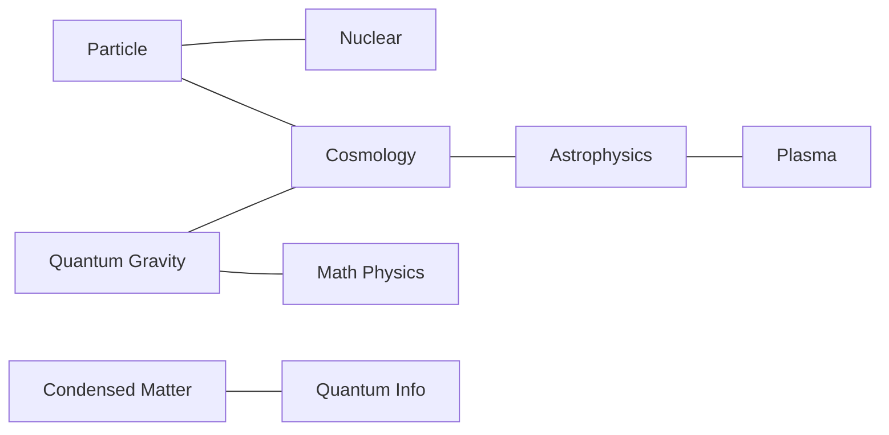

# Open physics problems by field

Physics is not one Erdős list — it is a **web of fields**. Every problem has:

- **`field`** — primary textbook home
- **`subfield`** — research-community slice
- **`fields_secondary`** — cross-domain edges
- **`cluster`** — mega-domain for navigation

See also [recent AI math publications](recent-ai-math-publications.md) for why catalogs matter.

## Clusters

### Fundamental structure (`fundamental`) — 34 problems

Laws, particles, gravity, mathematical skeleton of QFT/GR.

| Field | N | Page |
|-------|--:|------|
| General / Unification | 2 | [fields/general.md](fields/general.md) |
| Quantum Gravity | 10 | [fields/quantum-gravity.md](fields/quantum-gravity.md) |
| Mathematical Physics | 3 | [fields/mathematical-physics.md](fields/mathematical-physics.md) |
| Particle / High-Energy | 19 | [fields/particle-physics.md](fields/particle-physics.md) |

### Cosmos (`cosmic`) — 31 problems

Universe at large: dark sector, early universe, astrophysical engines.

| Field | N | Page |
|-------|--:|------|
| Cosmology | 14 | [fields/cosmology.md](fields/cosmology.md) |
| Astrophysics & Astronomy | 17 | [fields/astrophysics.md](fields/astrophysics.md) |

### Matter & continuum (`matter`) — 28 problems

Many-body, nuclear, fluids, plasmas — emergence and engineering physics.

| Field | N | Page |
|-------|--:|------|
| Condensed Matter | 13 | [fields/condensed-matter.md](fields/condensed-matter.md) |
| Nuclear Physics | 8 | [fields/nuclear-physics.md](fields/nuclear-physics.md) |
| Fluids & Soft Matter Dynamics | 3 | [fields/fluid-dynamics.md](fields/fluid-dynamics.md) |
| Plasma Physics | 4 | [fields/plasma-physics.md](fields/plasma-physics.md) |

### Quantum information (`quantum-info`) — 6 problems

Information-theoretic quantum physics and devices.

| Field | N | Page |
|-------|--:|------|
| Quantum Information & Computing | 6 | [fields/quantum-information.md](fields/quantum-information.md) |

### Living systems (`life`) — 8 problems

Physics of biological organization and origin.

| Field | N | Page |
|-------|--:|------|
| Biophysics | 8 | [fields/biophysics.md](fields/biophysics.md) |

### Foundations (`foundations`) — 5 problems

Conceptual structure of physical theory.

| Field | N | Page |
|-------|--:|------|
| Foundations | 5 | [fields/foundations.md](fields/foundations.md) |

## Cross-field intuition

