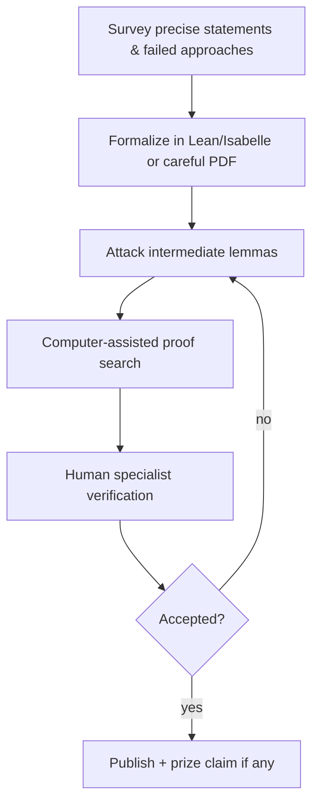
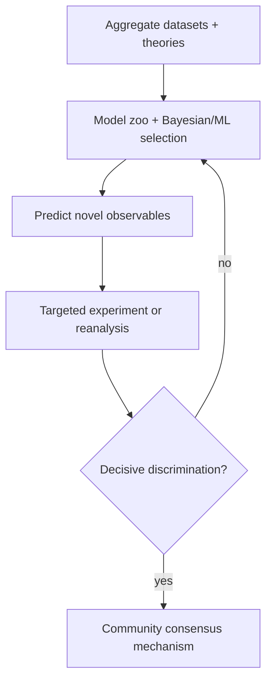
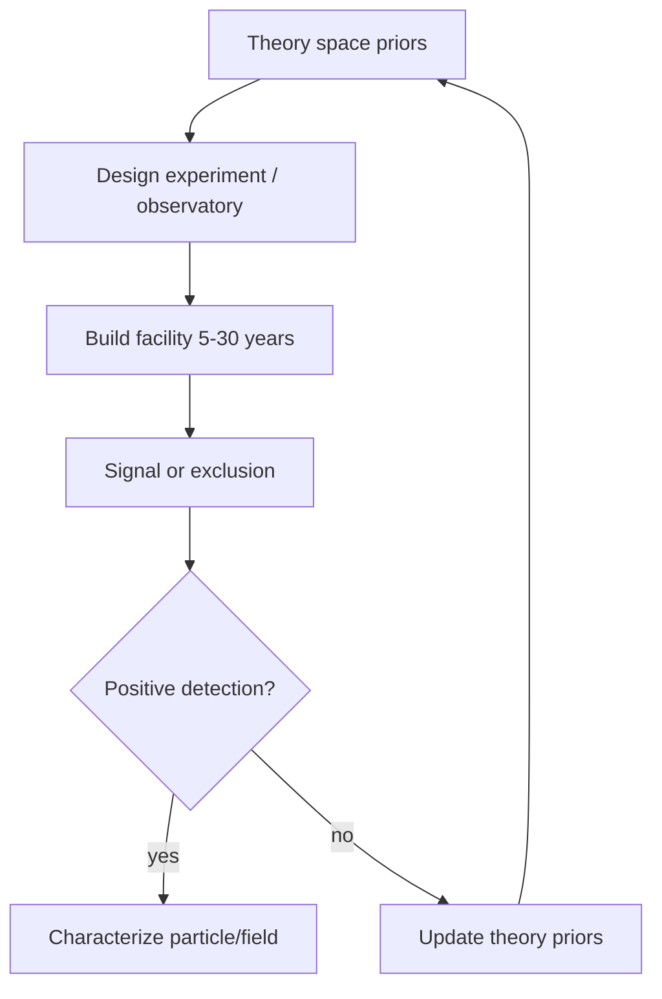
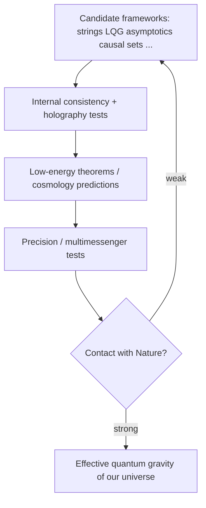

# End-to-End Research Paths

How one might actually attack classes of open problems — from literature to closure criteria.

## Path A — Formal mathematical physics (AI-favorable)

**Examples:** Yang–Mills mass gap, Navier–Stokes, confinement proof pieces, quantum capacity.

**Closure criterion:** Peer-reviewed proof (Clay rules if applicable).

## Path B — Mechanism from rich data (AI-favorable)

**Examples:** high-Tc mechanism, glass, turbulence stats, DIBs, FRB model ranking, neutron lifetime systematics.

**Closure criterion:** One mechanism predicts out-of-sample data better than rivals; textbooks converge.

## Path C — Discovery / identity problems (AI-unfavorable alone)

**Examples:** dark matter identity, proton decay, SUSY, neutrino Majorana nature.

**Closure criterion:** Direct detection / decay observation / or exhaustive exclusion of natural windows.

## Path D — Quantum gravity / TOE (generational)

**Closure criterion:** Not elegance alone — predictive contact with observation.

## Path E — Foundations (may never unique-close)

**Examples:** QM interpretation, arrow of time deep 'why', quantum mind.

Closure may mean **clarified option space + experimental constraints**, not a single orthodoxy.
