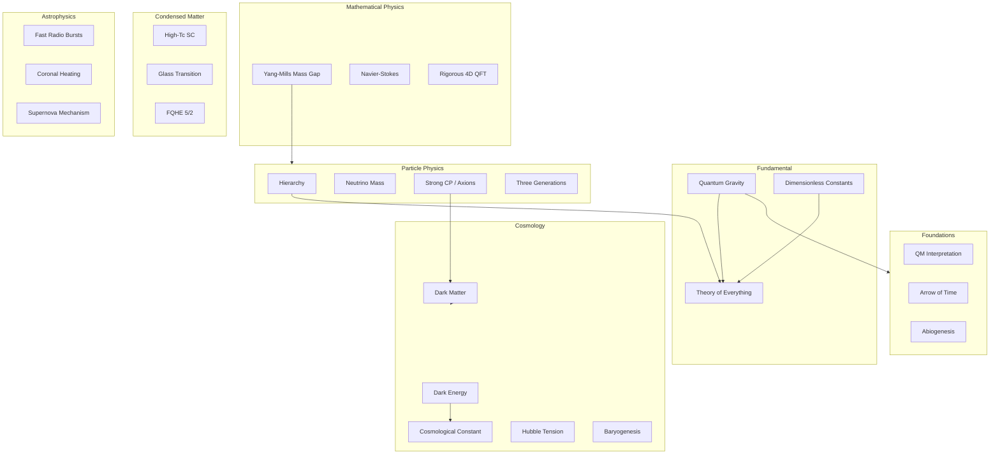
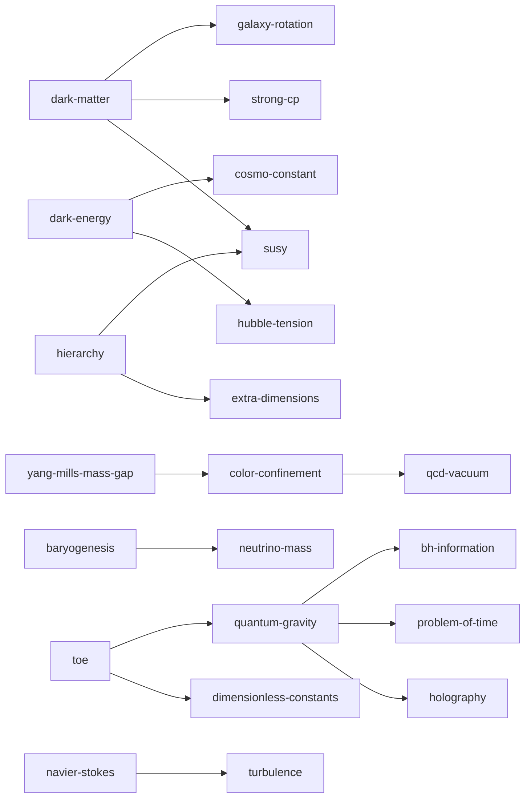

# Physics Open Problems Landscape Map

A multi-axis map of **112** curated open problems synthesized from Wikipedia, Baez FAQ, Strings 2000, Clay Math, Ginzburg themes, and Snowmass-era frontiers.

## How to read this map

Each problem lives in a 2D space:

1. **Empirical gate** — how much new experimental/observational access is required
2. **Formal / theoretical closure** — how much of the problem is mathematical or conceptual

```
                    needs new experiment / facility
                              ▲
                              │
     dark matter  ·  proton decay  ·  SUSY  ·  fusion
     neutrino mass ·  GUT  ·  extra dimensions
                              │
  formal ◄────────────────────┼────────────────────► conceptual
  math                        │                      foundations
                              │
   Yang–Mills · Navier–Stokes │  QM interpretation · arrow of time
   confinement · turbulence   │  anthropic · TOE
   high-Tc · glass            │
                              │
                              ▼
                    closable from existing data / theory
```

## Domain constellation (Mermaid)



## Counts by field

| Field | Count |
|-------|------:|
| General / Fundamental | 2 |
| Quantum Gravity | 10 |
| Mathematical Physics | 3 |
| Cosmology & Relativity | 14 |
| High-Energy / Particle Physics | 19 |
| Astronomy & Astrophysics | 17 |
| Nuclear Physics | 8 |
| Fluid Dynamics | 3 |
| Condensed Matter | 13 |
| Quantum Computing & Information | 6 |
| Plasma Physics | 4 |
| Biophysics | 8 |
| Foundations of Physics | 5 |
| **Total** | **112** |

## Impact × Difficulty heatmap (text)

Problems with impact≥4 and difficulty≥4 (highest-stakes open frontiers):

| Problem | Field | AI | Kind |
|---------|-------|----|------|
| Abiogenesis | biophysics | low | theoretical |
| Arrow of time | foundations | low | foundations |
| Black hole information paradox | quantum-gravity | medium | theoretical |
| Color confinement (analytic proof) | particle-physics | high | mathematical |
| Cosmological constant problem | cosmology | low | theoretical |
| Dimensionless physical constants | general | low | theoretical |
| Emergence of spacetime | quantum-gravity | medium | theoretical |
| Grand unification | particle-physics | low | theoretical |
| Hierarchy problem | particle-physics | low | theoretical |
| High-temperature superconductivity mechanism | condensed-matter | high | theoretical |
| Holographic principle (general) | quantum-gravity | medium | theoretical |
| Interpretation of quantum mechanics / measurement problem | foundations | low | foundations |
| M-theory fundamental degrees of freedom | quantum-gravity | low | theoretical |
| Matter–antimatter asymmetry | cosmology | low | theoretical |
| Nature of dark energy | cosmology | low | experimental |
| Nature of dark matter | cosmology | low | experimental |
| Navier–Stokes existence and smoothness | fluid-dynamics | high | mathematical |
| Origin and fate of the universe | cosmology | none | theoretical |
| Proton decay | particle-physics | none | experimental |
| Quantum gravity | quantum-gravity | low | theoretical |
| Rigorous interacting 4D QFT | mathematical-physics | high | mathematical |
| Statistical theory of turbulence | fluid-dynamics | high | theoretical |
| Theory of everything | general | none | theoretical |
| Yang–Mills existence and mass gap | mathematical-physics | high | mathematical |
| Anthropic principle necessity | foundations | none | foundations |
| BQP vs BPP / NP relations | quantum-information | high | mathematical |
| Biology from fundamental physical laws | biophysics | medium | foundations |
| Cosmic censorship hypothesis | quantum-gravity | high | mathematical |
| Cosmic inflation details | cosmology | low | theoretical |
| Cosmological principle validity | cosmology | medium | experimental |
| Extra dimensions | particle-physics | low | experimental |
| Fault-tolerant quantum computing scalability | quantum-information | medium | engineering |
| Fusion plasma confinement / H-mode | plasma-physics | medium | engineering |
| Galaxy rotation problem | astrophysics | low | theoretical |
| Glass transition | condensed-matter | high | theoretical |
| Hawking radiation confirmation | quantum-gravity | low | experimental |
| Hubble tension | cosmology | medium | experimental |
| Neutrino masses and nature | particle-physics | low | experimental |
| Non-cryogenic quantum computing | quantum-information | low | engineering |
| Post-quantum cryptography proofs | quantum-information | high | mathematical |
| Problem of time | quantum-gravity | medium | foundations |
| QCD vacuum and nuclear complexity | nuclear-physics | medium | theoretical |
| Strong CP problem | particle-physics | medium | theoretical |
| Supersymmetry realization | particle-physics | low | experimental |
| Three generations of matter | particle-physics | low | theoretical |
| Why 3+1 spacetime dimensions | quantum-gravity | low | theoretical |
| Core-collapse supernova mechanism | astrophysics | high | theoretical |
| Fractional quantum Hall ν=5/2 state | condensed-matter | high | theoretical |
| Horizon problem / alternatives | cosmology | medium | theoretical |
| Large-scale cosmic anisotropy | cosmology | medium | experimental |
| Muon anomalous magnetic moment | particle-physics | medium | experimental |
| Nature of quantum non-locality | foundations | medium | foundations |
| Nature of the nuclear force from QCD | nuclear-physics | medium | theoretical |
| Neutron star dense matter EOS | nuclear-physics | medium | experimental |
| Protein folding physics (beyond structure prediction) | biophysics | high | theoretical |
| Quark–gluon plasma onset and properties | nuclear-physics | medium | experimental |
| Size, shape, and topology of the universe | cosmology | low | experimental |
| Supermassive black hole origins | astrophysics | medium | theoretical |
| Topological order at finite temperature | condensed-matter | high | theoretical |
| Topological qubits / Majorana modes | quantum-information | medium | experimental |

## Cross-links graph (sample core)



## Recently solved (contrast)

These left the open list in roughly the last ~30 years — useful calibration of what 'solvable' looks like:

- **Higgs boson / electroweak symmetry breaking** (2012) — LHC discovery
- **Gravitational waves direct detection** (2015) — LIGO GW150914
- **Solar neutrino problem / neutrino oscillations** (2001) — SNO and others
- **Short gamma-ray burst origin** (2017) — GW170817 + GRB 170817A
- **Missing baryon problem** (2017) — Hot intergalactic gas
- **Loophole-free Bell tests** (2015) — Local hidden variables ruled out at high confidence
- **Quark-gluon plasma creation** (2005) — RHIC/LHC; properties still studied
- **Pioneer anomaly** (2012) — Thermal recoil force
- **OPERA faster-than-light neutrinos** (2012) — Experimental error
- **Time crystals existence** (2016) — Driven quantum systems
- **Proton radius puzzle (largely)** (2022) — Consensus toward smaller radius
