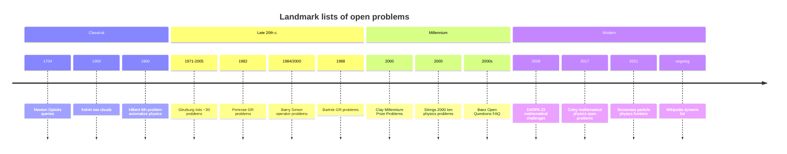
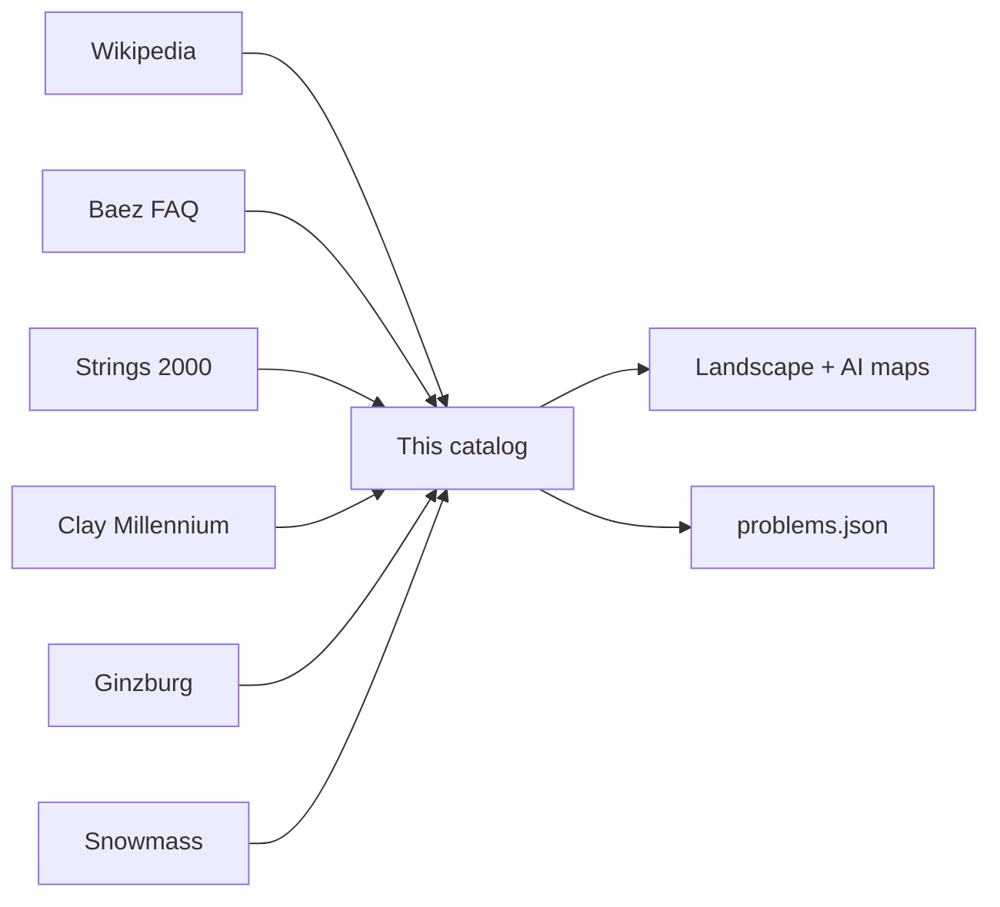

# Sources & Historical Lists Graph

Open physics problems are not one list — they are a **genealogy of lists** across communities.

## Timeline of major lists

## Source coverage matrix

| Source | Domain | Approx. problems | Role in this repo |
|--------|--------|----------------:|-------------------|
| Wikipedia unsolved physics | All fields | 100+ | Primary inventory backbone |
| Baez FAQ | CM, QM, cosmo, particle, QG | ~40 | Classic narrative + status updates |
| Strings 2000 | Fundamental theory | 10 | Prestige 'millennium' physics set |
| Clay Math | Math physics | 2 physics-related of 7 | Prize-backed formal problems |
| Ginzburg | Broad + 3 great problems | ~30 | Historical Russian school framing |
| Snowmass 2021 | Particle/cosmo experimental | many | Community experimental roadmap |
| Coley arXiv:1710.02105 | Mathematical physics | list | Formal open questions |

## Strings 2000 ten (still essentially open as of mid-2020s)

| # | Problem in this catalog | Original question |
|--:|-------------------------|-------------------|
| 1 | `dimensionless-constants` | Are dimensionless parameters calculable or accidents? |
| 2 | `quantum-gravity` | How can QG explain origin of the universe? |
| 3 | `proton-decay` | Proton lifetime? |
| 4 | `susy` | Is Nature supersymmetric? How broken? |
| 5 | `why-3plus1` | Why 3+1 dimensions? |
| 6 | `cosmo-constant` | Why this cosmological constant? |
| 7 | `m-theory-dof` | M-theory degrees of freedom; does it describe Nature? |
| 8 | `bh-information` | Black hole information paradox resolution? |
| 9 | `hierarchy` | Gravity vs particle mass scale disparity? |
| 10 | `color-confinement` | QCD confinement and mass gap quantitatively? |

## Source → problem graph

## Community taxonomies compared

| Community | Typical axes | What they optimize for |
|-----------|--------------|------------------------|
| High-energy theory | BSM, naturalness, unification | Deeper laws |
| Experimental HEP | Discovery reach, precision | Detectors & facilities |
| Cosmology | Early universe, DE/DM, surveys | Observational programs |
| Condensed matter | Emergence, materials, topology | Mechanisms & applications |
| Math physics | Existence, rigor, PDEs | Theorems |
| Foundations | Measurement, time, locality | Conceptual clarity |
| AMO / QI | Control, error, capacity | Devices |

Different lists answer different questions: **'what would rewrite textbooks?'** vs **'what can we fund next decade?'** vs **'what can we prove?'**.
